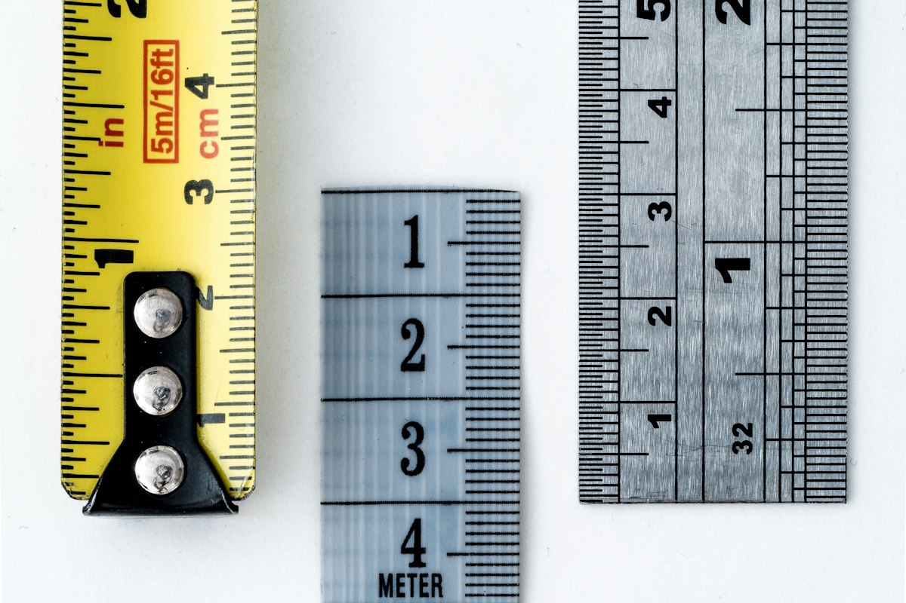

周五晚上翻 023 的账，本来只想确认一件事，能不能发。

这稿子十月一号过的审。之后正文改过，卡片重渲过，改了多少回我自己都记不清。十月三十号拿回来准备发，它早就不是当初那一版了，可所有记录上都写着过审。

那天我问了一句，为什么每次检查都能查出问题。这话不好接，因为它听着像在怀疑检查本身。

盘完我认了，检查没白做。真正的洞是过审这件事从来没绑过版本，检查是真的，结论会过期。全项目翻一遍，找不到任何一处记着哪一版、什么时候、过了哪几道闸。改一个字，之前所有结论就该作废，可表上的过审还挂着。没人骗我，是这套流程压根没记住改过。

{: width="1200" height="800"}

Photo by Phil Hearing on Unsplash

再往下看，闸门其实只剩一道是真的。脚本那层会 exit 1，首评口癖、单位符号、说痛不说疼、句长 CV、逗号句号比，全是正则和统计，它真会拦人。往上的证据闸门和人工闸门，全写在 skill 里，靠自觉跑。最上面那层是子代理对抗审查，它给的是采样，同一篇今天跑和下周跑，抽到的问题不一样，能抽到什么看运气。

还有更荒唐的一条。skill 里写着发布前必跑 sources.py，我去查了，那个目录早归档走了，跑起来就是 file not found。就算它还在，skill 自己也记着，它对小红书格式返回 exit 2，什么都没查。这道承诺了两年的证据闸门，一次都没跑成过。两年，零次。文档里挂着一条跑不了的规则，比没有更坏，它会让人以为已经查过了。

{: width="1200" height="800"}

Photo by Towfiqu barbhuiya on Unsplash

于是当晚动手。备份先做，打个 tag，再打一个 tar 包，两百九十七 K。然后加了三个脚本。三个，一夜写完。

gates.py 一次跑满十一道，每跑一次往 drafts/.gates 里写一份台账，记正文区 md5、首评区 md5、卡片 md5、每张图 md5、声称台账 md5，加上每道闸门的退出码和实测数字。gate_status.py 是发布前最后一道，重算这五处哈希跟台账比，对不上就判台账过期，这一版没被检查过。claim_ledger.py 管声称台账，正文每个带数字或结论的句子登记一行，写清原句、PMID、原文引句、方向，它拿引句去 PubMed 摘要里逐字比。

{: width="1200" height="800"}

Photo by Pankaj Patel on Unsplash

写脚本容易，难的是证明它会失败。我一条条试。正文改一个字，gate_status 报 exit 1，还原，exit 0。卡片 HTML 加一行注释，exit 1。把引句里的 35.7 天改成 12 天，claim_ledger 报引句在摘要里找不到。加 --offline，它 exit 2，明写跳过三条文献核对不算通过。它红了，我才敢用。

闸门不会失败，就等于没有闸门。这句写进 skill 的时候我觉得自己早就做到了，那天才发现没有。

夜里还漏了一处，是我自己没看出来的。023 那几张卡片，右下角的水印压在烫金双线框上。

我先量，用像素说话。水印深棕像素的包围盒是 y 2953 到 3280、x 1584 到 2397，金框的横线在 y 3204 到 3207 和 y 3224 到 3231，竖线在 x 2368 到 2371 和 x 2388 到 2395。水印整个罩在金框的横线和竖线上，右下角那一块就是压在框上。

为什么几何闸门没查出来，两个原因都不冤，而且都不是脚本写得不好。card_audit 只量水印到上方最近元素的垂直净空，报的是 52px 和 164px，看着很安全，它量错了方向。它比的是 DOM 里兄弟元素的包围盒，而金框是外层容器的 CSS border，水印是它的子元素，子元素在父元素框内，包围盒永远不相交，所以结构上就看不见字压在线上这件事。图片审查那一路更绝，四个视角收到的是从 HTML 抽出来的纯文字，根本没有图。就算给图，vision 也判不了几何。

所以补一道像素级闸门。这次管用了。

{: width="1200" height="800"}

Photo by William Warby on Unsplash

周日 024 跑全流程，十二道闸门全绿，CV 0.701，逗号句号比 2.26，实发九百六十二字。四个视角一共报了四十多条，我逐条回原文核，采纳的只有几处，其中一条是真硬伤。

那处写的是没有家族史也不胖的人新发糖尿病要警惕。我调 PMC 全文，原文先说既往有作者这么提过，紧接着自己推翻，在 240 例合并糖尿病的胰腺癌患者里，多数人发病前就超重或肥胖，而且这些危险因素在两组人里差不多。我把它的自我反驳当成了它的结论。全篇最严重的一处，是这么来的。

{: width="1200" height="800"}

Photo by Alexandr Popadin on Unsplash

还有四处是结论比原句走远了一小步。来得早又不典型的那几个才值得留意，原文明确写焦虑、抑郁、失眠的关联更弱。没胃口和背痛都是 54.2%，我写成了两个量级，可背痛在频率榜上垫底、在时间上却排第二，顺序是变了，不是倒过来。首评里有条写着四十岁以后加做增强 CT，跟正文两处五十岁直接打架。

顺手补了一条急诊指征，眼睛发黄、尿色像浓茶、大便变浅，或者上腹痛得厉害还伴呕吐发烧，不用等组合信号，尽快去医院。原来全篇一条都没有。

一号傍晚又翻出一笔账。流程里写着每篇文章的引用文献必须同步进 Zotero 合集，我抽了 021 到 025 共 20 条 PMID 去核。025 五条只进了三条，缺的那两条是当天写稿时新补的，补完直接进了闸门，没有任何一步检查它们有没有入库。023 更怪，两条 PMID 各有重复，旧的那条缺字段。

于是又加一道，zotero_check 读草稿 frontmatter 的 PMID，直接查 zotero.sqlite，缺条目报硬错，标签对不上报提示，文章发了文献没入库这件事以后混不过去。重复的按有没有 PDF 留一条，五组处理完，按 PMID 查已经不重复了，删掉的一律进回收站，字段快照先存一份 JSON 留档。

回头看周四早上，另一条线塌了。PubMed 直连被墙，走代理必然失败，只有 Cloudflare 这类域名正常。查下来 Clash 进程好好活着，7890 也通，是路由规则把 nih.gov、ncbi.nlm.nih.gov、arxiv.org 全塞进了 Google 组，那个组下面挂的三台美国固定节点全部超时。

{: width="1200" height="800"}

Photo by Scott Rodgerson on Unsplash

我先更新订阅。真正变的是全部 29 个 SS 节点的 obfs 落地域名被轮换，比如 US-Fixed-01 从 default.nintendo.es 换成 default.microsoft.lv，四个 TLS-L1 节点被供应商直接下架。换完再测，美国那三台还是死的，alive 是 false，超时放宽到十五秒也全超时。这是对方那组机器挂了，不是本地配置。

中间我差点走另一条路，把首选节点写进配置固化下来。想过之后否了，坏处都实在，一条都不小。节点名一硬编码，就等于把此刻哪台机器好写进了配置，机场改个组名它就静默失效，界面上还显示已生效。它能盖住症状，盖不住故障。换台机器，一样得重来。

真正的毛病在路由层，不在节点选择层。往 profile 的 prepend 规则里加四条，把 ncbi.nlm.nih.gov、pubmedcentral.nih.gov、nih.gov、arxiv.org 全部指向 Default Proxy，再 PUT /configs 重载。实测四个域名全 200，esummary 带 key 查了一条，元数据完整。prepend 写在独立的编辑规则文件里，订阅每十二小时更新也不覆盖。

同一条思路周一也用过一次，只是那次的对象是这台机器自己。

开机之后 WSL 和 hermes 都没起来，我原以为是没自启。翻 journalctl 才发现它启动过，两分二十七秒之后自己正常关机了。两分半。二十点二十三分五十八秒 VM 起来，gateway 二十点二十四分 Started，二十点二十六分二十五秒 systemd 正常执行 Shutting down，日志里连一条 getaddrinfo 都没有。这是干净的 poweroff，不是崩溃，也不是网络自检没过。

根因是那个 wsl.exe -- true。它执行完 true 立刻退出，是没有前端保持的短命会话，最后一个会话退出，WSL2 判定空闲，按超时把整个 VM 关掉。计划任务报 LastResult 0 也没骗人，wsl.exe 确实成功退出了，只是这个成功等于自杀，退得越干净死得越快。以前能撑七天，是因为 Terminal 里开着一个 WSL 标签在给它续命。

vbs 升到 v3，核心是把 -- true 换成 -- sleep infinity，留一个隐藏的常驻会话来保住 VM。顺手踩了个坑，判活用的 pgrep 会把 wsl.exe 的包装进程和 pgrep 自己一起匹配进来，实测返回三行，幂等判断恒真，keeper 死了也不重启。改成锚定整行才对。

{: width="1200" height="800"}

Photo by Artin Bakhan on Unsplash

家里那条线也在改流程。孩子妈妈想每天记作业和作息，我一开始给的是个大表，被否了，说太复杂，而且这表只有大人操作，不该让孩子自己填。最后定成腾讯文档里的一张收集表，约定九点上床，超一分钟扣一块钱，特殊情况例外，周末电视时间单独限定额度，违约换额度。规则是死的，钱也是真扣。

孩子问过能不能做成 app，算过能，但没必要，先做网页版，手机上打开就能写，多台设备同步靠云端。九岁的孩子照不照搬柳比歇夫那套时间统计，我也查了，原版要求分钟级自我记录和事后统计，负担全压在工作记忆和元认知上，这两项恰好是九岁最弱的地方。有研究让孩子和成人做同一个每五分钟报时的任务，孩子要多检查很多次钟才能达到同样准确度，作者的结论是孩子更依赖外部线索把握时间。可行的做法是往下简化一层，家长记录，计时器显示，孩子只做先预估后核对。

{: width="1200" height="800"}

Photo by Annie Spratt on Unsplash

科里那张排班表也顺手规则化了。原本一个月的周末查房是零散排的，谁有空谁上，定下三条规则之后，十一月四个周末全覆盖，我四天、梅盛民三天、张富四天，没有空档。规则写进 skill，下个月不用再交代一遍。

{: width="1200" height="800"}

Photo by Eric Rothermel on Unsplash

门诊和私信问的都是报告单。体检发现脾大要不要紧，我给的结论是多数没问题，看大多少和有没有伴随异常，十二厘米不是硬线，一千二百三十名健康人的超声实测里男性 26% 本身就超过十二厘米。这条进了候补池，等明年三月体检季。

还有一条私信，产后九个月、结石 0.6 厘米，问有没有机会消掉。我自己回的那版被留下来当范本，孕期结石确实有一部分会消，但产后九个月还在，继续消的可能性就低，后面要不要处理看有没有发作痛过，一次都没痛过，半年到一年复查一次 B 超就行。

{: width="1200" height="800"}

Photo by Nguyen Dang Hoang Nhu on Unsplash

小红书的数据采集也降了频。原来按 D1、D3、D7 逐日打点，现在改成一周导出一次，巡检脚本不再每天催，改看上次导出隔了几天。skill 里散落的六处逐日说法一并清了。

这一周改的东西，没有一样是内容本身。全是确认的事，确认过审绑不绑版本，确认引句在不在原文，确认水印压没压线，确认那条流量该走哪个节点。

稿子写得好不好，我大概还有点判断。它到底有没有被查过，这件事以前我不敢说，现在敢了，因为查不过就跑不起来。

Cover photo by Jose Fontano on Unsplash

*本文由Hermes自动整理*
